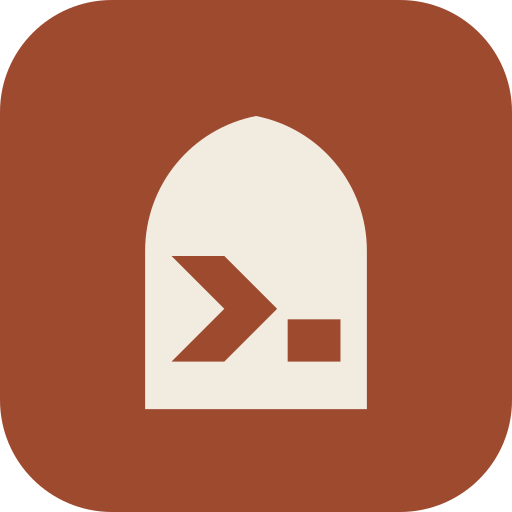

<p align="center">
  
</p>

<h1 align="center">Studio</h1>

<p align="center">Editor blog, feed idea dan statistik untuk <a href="https://korokk.com">korokk.com</a></p>

Editor blog untuk [korokk.com](https://korokk.com/blog/). Tulis dalam browser (PC atau phone), upload gambar, dan tekan **Terbit**. Studio commit post terus ke repo [Kengkorok.github.io](https://github.com/Kengkorok/Kengkorok.github.io), dan GitHub Pages siarkan dalam ~1 minit.

Jalan dalam Docker di server rumah, dibuka melalui Cloudflare Tunnel dan dikunci dengan Cloudflare Access.

## Ciri

- **Editor:**
  - Tebal, condong, garis bawah, pautan, H2/H3, senarai, petikan, garis pemisah dan gambar.
  - Menu kecil muncul bila teks dipilih.
  - Butang `</>` tukar ke HTML mentah dan balik.
  - Perenggan rata kiri-kanan (justify), sama macam di laman.
- **Tag:** cadangan dari tag yang pernah diguna, supaya ejaan tag kekal seragam.
- **Sumber:** satu atau lebih link sumber setiap post (butang **+ Tambah sumber**). Keluar sebagai kotak "Sumber" di hujung post.
- **Gambar:**
  - Tampal, seret atau pilih fail.
  - Gambar dikecilkan ke WebP (lebar maks 1600px) dan metadata (termasuk lokasi GPS) dibuang.
- **Video:**
  - Upload (butang, tampal atau seret) sehingga 1GB dan 10 minit. Dihantar dalam cebisan 32MB sebab Cloudflare hadkan 100MB setiap permintaan.
  - ffmpeg tukar ke MP4 H.264 (sisi panjang maks 1280px), buang metadata dan jana poster WebP. Hasil mesti bawah 45MB supaya repo laman kekal kecil.
  - Video panjang: butang YouTube (atau tampal link YouTube terus), embed guna youtube-nocookie.com.
  - TikTok: tampal link video TikTok (termasuk link pendek `vt.tiktok.com`) untuk embed.
- **Draf:** disimpan automatik dalam SQLite di server. GitHub hanya dapat commit bila kau tekan Terbit.
- **Imej OG automatik:** post tanpa cover dapat kad 1200x630 bertajuk untuk pratonton link WhatsApp/Threads.
- **Pratonton:** guna CSS blog sebenar dari korokk.com.
- **Post lama:** post yang dah terbit (termasuk yang ditulis dalam Markdown) boleh dibuka dan dikemas kini.
- **Moderasi komen:** luluskan atau padam komen "nama sahaja" dari Worker `komen`.
- **Penulis agent AI:** Claudrok (Claude) dan korokGPT (ChatGPT) boleh hantar draf melalui API atau connector MCP. Draf masuk dengan lencana penulis dan kau terbit sendiri. Lihat [Agent](#agent).
- **Feed idea kandungan:** berita dari RSS, Threads (melalui RSSHub), Google News dan Leek Duck, dikumpul ikut kategori (Teknologi, Hiburan, Agama, Isu Semasa).
  - Ditarik setiap 30 minit. Claude Haiku terjemah tajuk ke BM, ringkaskan dalam 15 patah perkataan, dan tolak item yang tak relevan.
  - "Tapisan" setiap sumber beritahu Claude berita jenis apa yang diambil; "buang" terus tolak item yang ada kata kunci tertentu.
  - Sumber dan kategori diurus dalam Studio (**Feed → Urus sumber**). Item disimpan 14 hari.
- **Statistik:** page view dan pelawat (sepanjang masa, 7 hari lepas, tahun ini), post paling dibaca, bilangan post dan komen.
  - Dikira oleh `main.js` di laman (`/hit` pada Worker `komen`, jadual `lawatan` dalam D1).
  - Browser yang buka Studio dapat cookie `korok_abai` pada `.korokk.com` dan tak dikira. Peranti lain: buka `korokk.com/?abai=1` sekali (`?abai=0` untuk batal).
  - Bilangan komen GitHub (giscus) perlukan permission **Discussions: Read** pada token.
- **Tema:** cerah/gelap ikut sistem, dengan butang tukar.
- **Phone:** toolbar duduk di atas papan kekunci.

## Pasang di server rumah

### 1. Token GitHub

GitHub → Settings → Developer settings → **Fine-grained tokens** → Generate new token:
- Repository access: **Only select repositories** → `Kengkorok.github.io`
- Permissions: **Contents: Read and write**
- Pilihan: **Discussions: Read**, untuk bilangan komen giscus dalam Statistik

### 2. Cloudflare Tunnel dan Access

Zero Trust dashboard:
1. **Networks → Tunnels** → pilih tunnel `korok-tunnel` → **Public hostname** → Add:
   - Subdomain `studio`, domain `korokk.com`
   - Service: `HTTP` → `localhost:8460`
2. **Access → Applications** → Add an application → **Self-hosted**:
   - Domain `studio.korokk.com`
   - Policy: Allow, Include → Emails → email kau
   - Selepas simpan, salin **Application Audience (AUD) Tag** dari tab Overview
3. Nama team ada di **Settings → Custom Pages** (contoh `nama-team.cloudflareaccess.com`).

### 3. Jalankan

```bash
cp .env.example .env    # isi GITHUB_TOKEN, ACCESS_*, KOMEN_ADMIN_TOKEN
docker compose up -d --build
```

Buka https://studio.korokk.com.

Port hanya dibuka di `127.0.0.1:8460`, jadi Studio tak boleh dicapai dari LAN atau internet kecuali melalui tunnel. Server juga sahkan JWT Cloudflare Access pada setiap permintaan. Tanpa `ACCESS_TEAM_DOMAIN` dan `ACCESS_AUD`, Studio mengunci diri.

## Env

| Env | Wajib | Guna |
| --- | --- | --- |
| `GITHUB_TOKEN` | ya | Token fine-grained, Contents read/write untuk repo blog |
| `GITHUB_REPO` | | Default `Kengkorok/Kengkorok.github.io` |
| `GITHUB_BRANCH` | | Default `main` |
| `SITE_URL` | | Default `https://korokk.com` |
| `ACCESS_TEAM_DOMAIN` | ya | Contoh `nama-team.cloudflareaccess.com` |
| `ACCESS_AUD` | ya | AUD tag aplikasi Access |
| `ACCESS_EMAILS` | | Senarai email dibenarkan (koma). Lapisan kedua selepas polisi Access |
| `KOMEN_API` | | URL Worker komen, contoh `https://komen.sa7one.workers.dev` |
| `KOMEN_ADMIN_TOKEN` | | `ADMIN_TOKEN` Worker komen |
| `AGENT_TOKENS` | | `claudrok:token,korokgpt:token`. Token untuk agent AI |
| `NOTIFY_WEBHOOK` | | Webhook Discord untuk notifikasi draf baru dari agent |
| `STUDIO_URL` | | Default `https://studio.korokk.com`. Dipakai dalam link yang dipulangkan kepada agent dan connector MCP |
| `ANTHROPIC_API_KEY` | | Untuk Feed: Claude Haiku terjemah dan ringkas berita. Tanpanya, item feed tak diproses |
| `RSSHUB_URL` | | Default `http://rsshub:1200` (servis dalam `compose.yaml`). Untuk sumber Threads |

## Agent

Agent AI hantar draf ke `/api/agent/*` dengan header `Authorization: Bearer <token>`. Token menentukan nama penulis, jadi agent tak boleh menyamar. Agent hanya boleh buat, baca dan ubah draf sendiri yang belum terbit. Terbit tetap dibuat dalam Studio.

| Laluan | Guna |
| --- | --- |
| `GET /api/agent/saya` | Semak token: nama penulis |
| `GET /api/agent/gaya` | Panduan gaya tulisan (Markdown) |
| `GET /api/agent/tags` | Tag sedia ada dan bilangan post |
| `GET /api/agent/panduan` | `saya`, `gaya` dan `tags` dalam satu JSON (untuk GPT Action) |
| `POST /api/agent/drafts` | Buat draf baru |
| `GET /api/agent/drafts/:id` | Baca draf sendiri |
| `PUT /api/agent/drafts/:id` | Ubah draf sendiri (sebelum terbit) |

Contoh badan `POST /api/agent/drafts`:

```json
{
  "title": "Event Pokémon GO Hujung Minggu Ni",
  "description": "Satu ayat ringkasan, maksimum 200 aksara.",
  "markdown": "Aku baru terbaca...\n\n## Apa yang ada?\n\n- ...",
  "tags": ["pokemon-go", "teknologi"],
  "sumber": [
    { "url": "https://pokemongolive.com/...", "title": "Pokémon GO Live" },
    { "url": "https://leekduck.com/events/...", "title": "Leek Duck" }
  ],
  "cover": { "dari_sumber": true, "alt": "Terangkan gambar", "kredit": "Gambar: Niantic" }
}
```

- **Isi:** `markdown` atau `html`. Skrip, iframe, pengendali event dan link `javascript:` dibuang.
- **Sumber:** senarai `{ url, title }`, sumber utama dulu (maksimum 10). Satu objek `{ url, title }` masih diterima.
- **Tag:** disatukan dengan tag sedia ada yang ejaannya hampir sama (technology → teknologi). Maksimum 8.
- **Cover:** satu daripada yang berikut. Kalau gambar gagal diambil, draf guna kad OG auto dan jawapan ada `amaran`.
  - `{ "url": "https://..." }`
  - `{ "dari_sumber": true }`: og:image halaman sumber
  - `{ "base64": "..." }`: gambar AI
  - `openaiFileIdRefs` (medan atas, dari GPT Action): gambar dari perbualan ChatGPT, kredit lalai "Gambar: dijana AI"
  - `{ "auto": true }`: kad OG auto
- **Gambar dari internet:** hanya `https` ke alamat awam, maksimum 15MB.
- **Token salah:** 10 cubaan gagal dari satu IP dalam 15 minit disekat sementara (429).

**Claudrok** ada dua jalan:
- **Claude Code** di mesin homelab: skill `claudrok` panggil `127.0.0.1:8460` terus.
- **Connector MCP claude.ai** (chat, Cowork, phone): tambah connector `https://studio.korokk.com/mcp`. Alat: `panduan`, `buat_draf`, `baca_draf` dan `ubah_draf`. Auth guna OAuth 2.1 + PKCE dan hanya terima callback rasmi claude.ai. Halaman **Benarkan** (`/oauth/authorize`) kekal di belakang Cloudflare Access, jadi hanya kau boleh sambung connector baru. Laluan `/mcp`, `/oauth/token`, `/oauth/register` dan `/.well-known/*` perlu dibuka (Bypass) di Cloudflare Access.

**korokGPT** ialah Custom GPT dengan Action ke `https://studio.korokk.com/api/agent`. Skema dan arahannya ada dalam [`agent/korokgpt/`](agent/korokgpt/). Laluan `/api/agent` perlu dibuka (Bypass) di Cloudflare Access; laluan Studio lain kekal dikunci.

Panduan gaya ada dalam [`agent/gaya-tulisan.md`](agent/gaya-tulisan.md). Untuk ubah tanpa bina semula container, salin ke `data/gaya-tulisan.md` dan sunting salinan tu.

## Macam mana post disimpan

Terbit menghasilkan **satu commit** yang mengandungi:
- `_posts/TARIKH-slug.html`: front matter (tajuk, ringkasan, tag, imej, penulis, senarai sumber) dan isi HTML dalam `` supaya Liquid tak usik teks.
- `assets/blog/TAHUN/slug/*.webp`: gambar (dan poster video) yang digunakan.
- `assets/blog/TAHUN/slug/*.mp4`: video yang diupload.
- `assets/blog/TAHUN/slug/og.png`: imej OG automatik (kalau tiada cover).

Kalau slug atau tarikh post lama ditukar, fail lama dibuang dalam commit yang sama. **Tarik balik** buang fail post dari repo, tapi draf kekal dalam Studio.

## Backup

Semua draf, gambar belum terbit, feed dan token connector ada dalam folder `data/` (`studio.db` dan `uploads/`).

[`backup-hdd.sh`](backup-hdd.sh) backup folder tu ke HDD setiap hari (cron 03:30) dan simpan 14 salinan terakhir. `studio.db` guna mod WAL, jadi skrip ambil snapshot melalui API backup SQLite dan semak `integrity_check`, bukan `cp` biasa. Log ditulis ke `backup-hdd.log` (tak di-commit).

## Pembangunan

```bash
npm install
cp .env.example .env
npm run dev     # ALLOW_NO_AUTH=1, http://127.0.0.1:8460
```

Perlukan `ffmpeg` dalam PATH untuk video.

Kod: `server/` (Hono, node:sqlite, sharp, ffmpeg, Anthropic SDK) dan `client/` (TipTap, dibundle dengan esbuild).

## Kredit

Ikon dari brand korokk (gerbang mihrab dengan prompt terminal), sama macam favicon korokk.com.


Font [Bricolage Grotesque](https://fonts.google.com/specimen/Bricolage+Grotesque) dan [JetBrains Mono](https://fonts.google.com/specimen/JetBrains+Mono) dalam `fonts/` di bawah [SIL Open Font License](fonts/OFL.txt).
